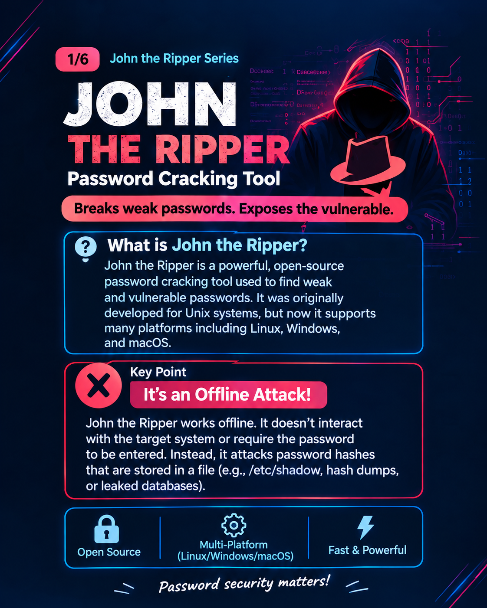
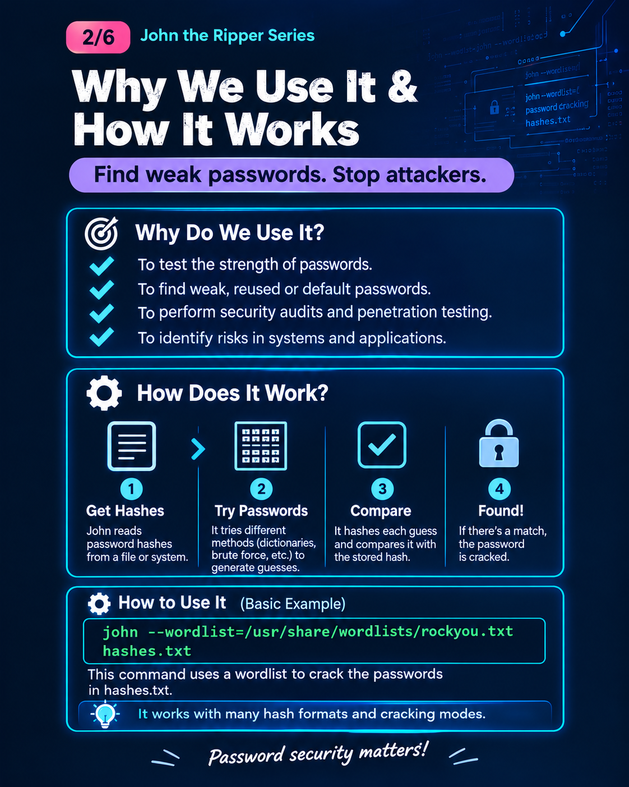
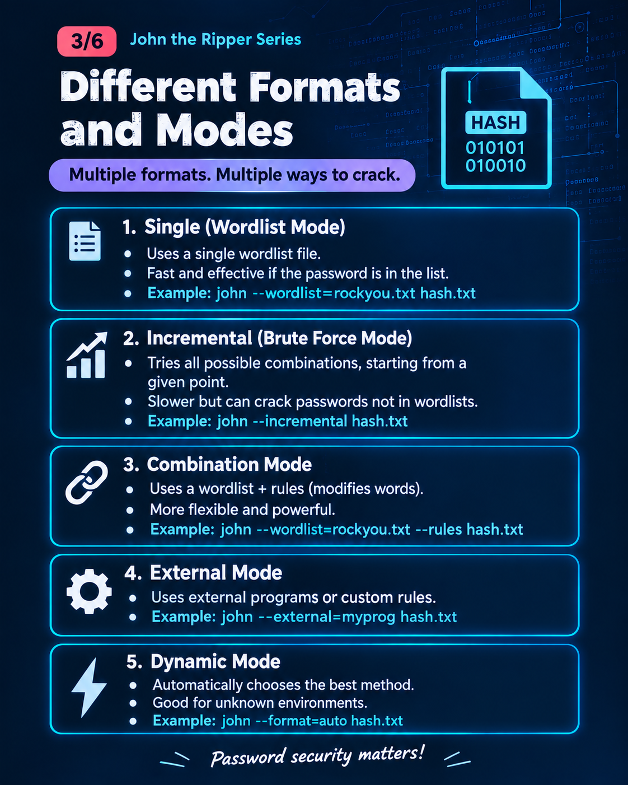
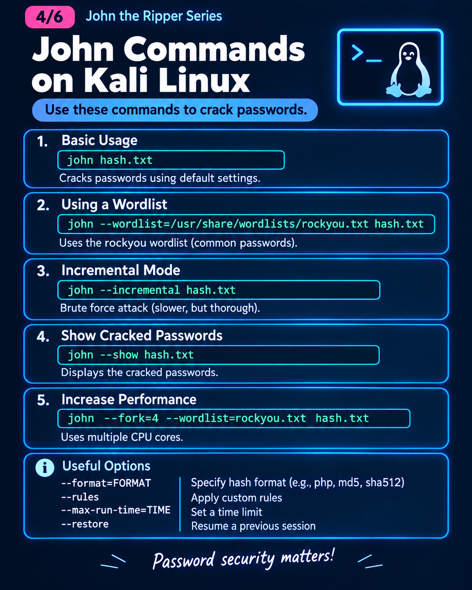
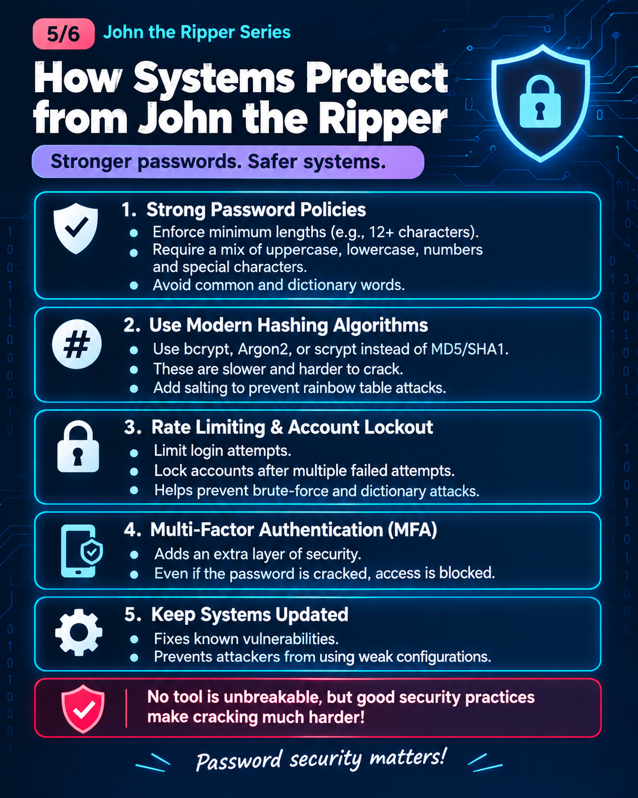
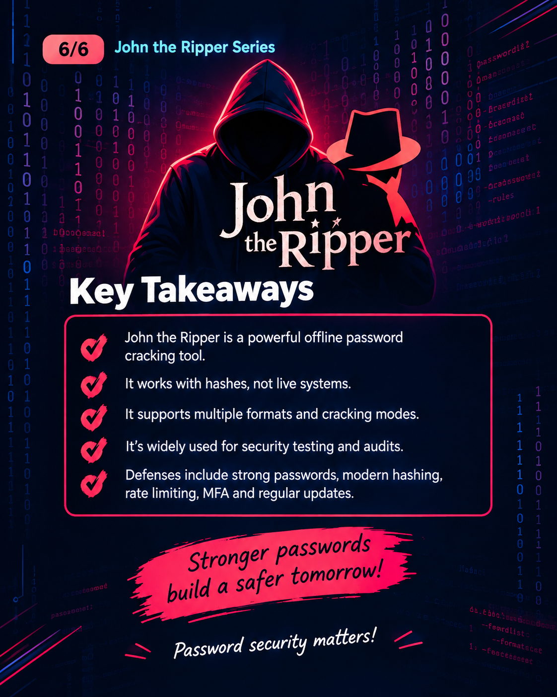

# 🔐 John the Ripper — Cybersecurity Learning Notes

Welcome to my **John the Ripper learning notes**!

As part of my cybersecurity learning journey, I studied John the Ripper, an open-source password-auditing and password-recovery tool. These notes explain its purpose, working process, different modes, Kali Linux commands, and the security measures used to protect passwords.

I have also included six visual posters to make the concepts easier to understand.

> **Ethical use:** All password auditing and practical exercises should be performed only on hashes and systems you own or have explicit permission to test.

---

## 📚 Table of Contents

1. [What Is John the Ripper?](#1-what-is-john-the-ripper)
2. [Why Do We Use It and How Does It Work?](#2-why-do-we-use-it-and-how-does-it-work)
3. [John the Ripper Modes](#3-john-the-ripper-modes)
4. [John the Ripper Commands on Kali Linux](#4-john-the-ripper-commands-on-kali-linux)
5. [How Systems Protect Passwords](#5-how-systems-protect-passwords)
6. [Key Takeaways](#6-key-takeaways)
7. [Learning Resources](#7-learning-resources)

---

# 1. What Is John the Ripper?

John the Ripper, often called **John**, is an open-source password-auditing and password-recovery tool. It is used to test password candidates against supported password hashes.

It was originally developed for Unix systems and now supports multiple operating systems and many password-hash formats.

### What is its purpose?

- To audit password strength.
- To identify weak, common, or predictable passwords.
- To help authorized security professionals assess password security.
- To test whether password policies and storage methods provide adequate protection.

### Why is it called an offline attack tool?

John the Ripper can test password guesses locally against obtained password hashes, without submitting each guess to the original website's login page.

For this type of offline password attack, the tester needs the relevant hash data and a compatible method for processing it.

### How does it work?

1. Obtain password hashes from an authorized test environment.
2. Choose or generate candidate passwords.
3. Use John the Ripper to test candidates against the hashes.
4. Review whether any candidates match.

**Important:** John the Ripper does not decrypt a hash. It tests candidate passwords and checks whether their calculated results match the stored hash data.

### 📸 Poster 1 — Introduction to John the Ripper




# 2. Why Do We Use It and How Does It Work?

John the Ripper is useful for understanding how weak passwords can put systems at risk.

### Why do we use it?

- **Password auditing:** Identify weak passwords in authorized assessments.
- **Security testing:** Evaluate password policies and password storage.
- **Password recovery:** Help recover passwords from supported hashes when authorized.
- **Education:** Learn how password guessing and password-hash verification work.

### How does it work?

**Step 1 — Obtain hash data**

A security tester obtains password hashes from a system or lab they are authorized to assess.

**Step 2 — Select password candidates**

Candidates may come from a wordlist or be generated according to a chosen strategy.

**Step 3 — Test candidates**

John processes the candidates using the appropriate supported hash format and settings.

**Step 4 — Compare results**

If a candidate matches a stored hash, John can report the recovered candidate.

### Example

Suppose an authorized lab contains a password hash created from a weak password. A suitable wordlist contains that password as one of its candidates.

John tests the candidates and may find a match. If the password is not present in the wordlist, that particular wordlist attempt may not find it.

**Remember:** Results depend on the password, hash format, available candidates, configuration, and computing resources.

### 📸 Poster 2 — Why We Use It and How It Works



---

# 3. John the Ripper Modes

John the Ripper supports different password-testing modes. Each mode uses a different strategy for generating or modifying password candidates.

## 3.1 Single-Crack Mode

Single mode uses information associated with usernames and other account details to generate password candidates, where supported by the input format.

It can be useful when passwords are related to account information.

## 3.2 Wordlist Mode

Wordlist mode tests candidates from a list of words or passwords.

For example, a wordlist may contain common passwords or candidates created for an authorized test.

It is useful when the expected password may already be included in the list.

## 3.3 Incremental Mode

Incremental mode generates combinations of characters according to its configured character set and limits.

It can explore candidates that are not present in a wordlist, but the search space can become extremely large.

Its effectiveness depends on configuration, password length, character choices, and available computing resources.

## 3.4 Wordlist with Rules

Rules modify words from a wordlist to create additional candidates.

For example, a rule may change capitalization or add characters to a word. This can help test predictable variations of common passwords.

## 3.5 External Mode

External mode allows custom candidate-generation logic to be defined using the supported configuration mechanisms.

It is useful for specialized auditing scenarios but requires additional configuration and understanding.

## 3.6 Automatic Mode Selection

When John is run without an explicitly selected cracking mode, it can use its default or automatic strategy according to its configuration and the input.

The exact behavior depends on the John version, build, configuration, and hash format.

### Quick Comparison

| Mode | How it works |
|---|---|
| Single | Generates candidates using account-related information |
| Wordlist | Tests candidates from a wordlist |
| Incremental | Generates character combinations |
| Wordlist with rules | Modifies wordlist candidates |
| External | Uses configured custom candidate-generation logic |
| Default/automatic | Uses the tool's default strategy and configuration |

### 📸 Poster 3 — Different Formats and Modes



---

# 4. John the Ripper Commands on Kali Linux

John the Ripper is commonly available in Kali Linux. The following examples demonstrate basic use with an authorized lab hash file.

Use a test hash file that you created yourself or have explicit permission to audit. Do not use these examples against other people's accounts or password databases without authorization.

## 4.1 Check the Version

```bash
john --list=build-info
```

Displays build and version information supported by the installed John version.

## 4.2 View Help

```bash
john --help
```

Displays available options and usage information.

## 4.3 Basic Usage

```bash
john lab_hashes.txt
```

Runs John using its default strategy against the hashes in the authorized test file.

## 4.4 Wordlist Mode

```bash
john --wordlist=lab_wordlist.txt lab_hashes.txt
```

Tests candidates from `lab_wordlist.txt` against the hashes in `lab_hashes.txt`.

## 4.5 Incremental Mode

```bash
john --incremental lab_hashes.txt
```

Uses incremental candidate generation according to the installed configuration.

## 4.6 Show Recovered Passwords

```bash
john --show lab_hashes.txt
```

Displays results John has already recovered and recorded for that hash file.

## 4.7 Specify a Hash Format

```bash
john --format=FORMAT lab_hashes.txt
```

Replace `FORMAT` with the actual supported format that matches your lab hashes. The format must be correct; it should not be guessed blindly.

To inspect available formats, use:

```bash
john --list=formats
```

Some builds support additional format-listing options.

## 4.8 Useful Options

| Option | Purpose |
|---|---|
| `--help` | Displays help |
| `--wordlist=FILE` | Uses a specified wordlist |
| `--incremental` | Selects incremental mode |
| `--show` | Displays previously recovered results |
| `--format=FORMAT` | Specifies the hash format |
| `--list=formats` | Lists supported formats in the installed build |

### Important Notes

- Hash files must contain data in a format John can understand.
- Not every hash type is supported by every build.
- A successful test depends on selecting the correct format and appropriate candidates.
- Use only authorized test data.
- Command options may differ between versions and builds; consult the installed help and official documentation.

### 📸 Poster 4 — John the Ripper Commands on Kali Linux



---

# 5. How Systems Protect Passwords

John the Ripper helps demonstrate why strong password storage and good security practices matter.

## 5.1 Strong Password Policies

Encourage long, unique passwords and block commonly used or compromised passwords. Password managers can help users create and store unique passwords.

## 5.2 Modern Password-Hashing Methods

Systems should use purpose-built password-hashing methods such as:

- **Argon2id:** Uses configurable memory and time costs.
- **bcrypt:** Uses an adjustable computational cost.
- **scrypt:** Is designed to be memory-intensive.
- **PBKDF2:** Uses repeated password-based derivation operations.

These methods are designed to make password guessing more expensive when configured appropriately.

Plain SHA-256 alone is not a suitable password-storage method because it is fast to compute.

## 5.3 Unique Salts

A salt is a random value generated for a password record and stored with its hash and parameters.

Unique salts help prevent identical passwords from having identical stored hash records and make precomputed hash tables less useful.

A salt does not need to be secret.

## 5.4 Peppering

A pepper is an additional secret used by some password-storage designs. Unlike a salt, it is stored separately from the password-hash database and must be protected.

## 5.5 Rate Limiting and Account Protections

Rate limits, delays, monitoring, and suitable account protections can reduce online password guessing.

These measures do not directly limit guesses tested locally in an offline attack against obtained hashes.

## 5.6 Multi-Factor Authentication

MFA adds another authentication factor beyond the password. Even if a password is guessed or recovered, the additional factor can help prevent unauthorized access.

## 5.7 Keep Systems Updated

Security updates help address known vulnerabilities. Secure configuration and protection of password databases and application secrets are also important.

**Key lesson:** No single defense is enough. Strong passwords, appropriate password hashing, salts, protected secrets, MFA, monitoring, and updates work together to reduce risk.

### 📸 Poster 5 — How Systems Protect Passwords



---

# 6. Key Takeaways

- John the Ripper is an open-source password-auditing and recovery tool.
- It can test password candidates against supported password hashes.
- It can perform offline hash guessing without sending each candidate to the original website.
- Single, wordlist, incremental, rule-based, and external strategies generate or modify candidates in different ways.
- The tool's success depends on the password, hash format, configuration, candidates, and computing resources.
- Strong password-hashing methods make offline guessing more expensive.
- Unique salts, securely managed peppers, strong passwords, MFA, and good system security reduce password-related risks.
- Password auditing must be performed only with appropriate authorization.

### Final Message

**Understanding how password attacks work helps us build stronger password defenses.**

Cybersecurity is not just about running commands. It is about understanding what a tool does, what its results mean, and how to use that knowledge to improve security.

### 📸 Poster 6 — John the Ripper: Key Takeaways



---

# 7. Learning Resources

- **John the Ripper Official Website:** https://www.openwall.com/john/
- **John the Ripper Documentation:** https://www.openwall.com/john/doc/
- **OWASP Password Storage Cheat Sheet:** https://cheatsheetseries.owasp.org/cheatsheets/Password_Storage_Cheat_Sheet.html
- **NIST Digital Identity Guidelines:** https://pages.nist.gov/800-63-4/sp800-63b.html

---

## ⚖️ Ethical Use Disclaimer

This repository is part of my cybersecurity education and is intended for learning, authorized password auditing, and defensive security awareness.

Only test passwords, hashes, and systems you own or have explicit permission to assess.
